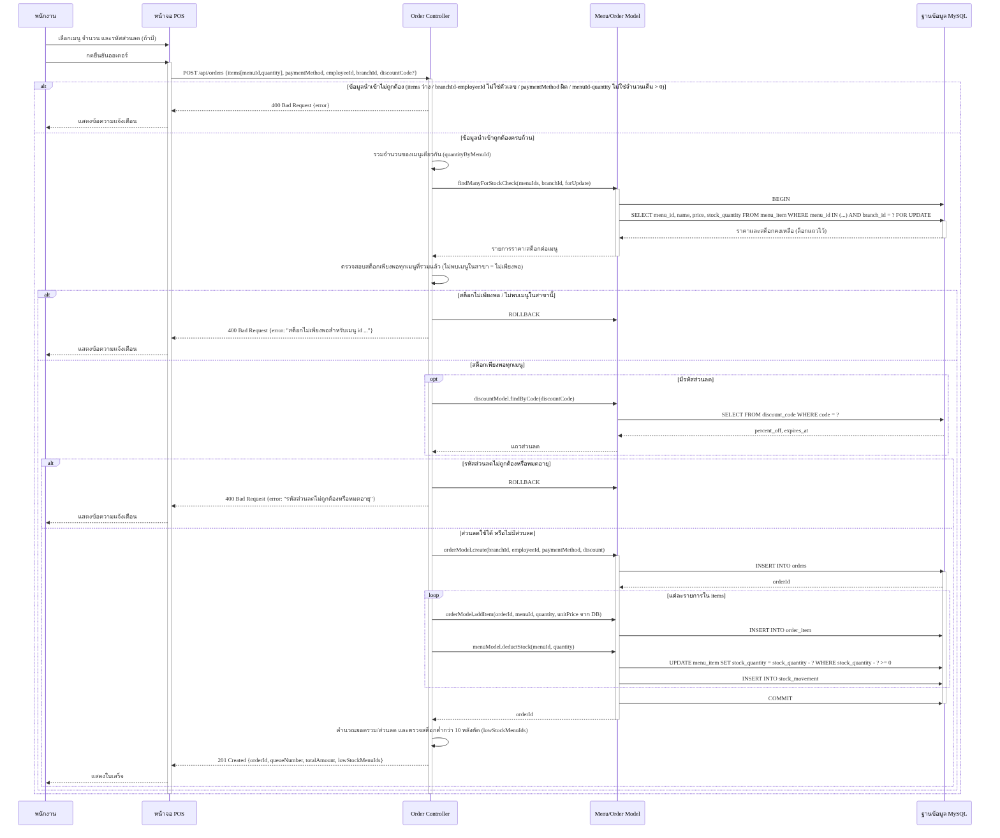
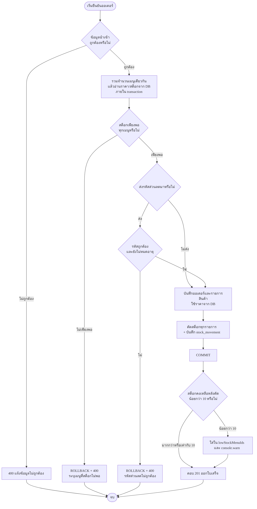

# wk09 Process Design: Flow การสั่งซื้อ (Coding Sprint 2)

## 1. Business Rule ของระบบ

1. หากจำนวนที่สั่ง (รวมทุกบรรทัดของเมนูเดียวกัน) มากกว่าสต็อกคงเหลือของสาขานั้น ระบบต้องปฏิเสธออเดอร์ (400)
2. เมื่อยืนยันออเดอร์สำเร็จ ต้องตัดสต็อกทันที และบันทึก `stock_movement` ทุกครั้ง
3. หากสต็อกหลังตัดน้อยกว่า 10 ต้องแจ้งเตือน (Sprint 2: ส่ง `lowStockMenuIds` ใน response + `console.warn`)
4. ราคาต้องมาจาก `menu_item.price` ในฐานข้อมูลเท่านั้น ห้ามรับจาก client
5. เมนูของแต่ละสาขาเป็นคนละแถวกัน ทุก query ต้องกรองด้วย `branch_id` (กัน IDOR)
6. ทั้งออเดอร์ต้องสำเร็จหรือล้มเหลวพร้อมกัน (transaction) รหัสส่วนลดผิดหรือสต็อกไม่พอ ต้อง rollback

## 2. Sequence Diagram

ต้นฉบับ mermaid: `docs-src/wk09-sequence.mmd` (participant 5 ตัว, alt ซ้อน 3 ชั้น, opt 1, loop 1)

## 3. Flowchart

ต้นฉบับ mermaid: `docs-src/wk09-flowchart.mmd`

## 4. ตารางจับคู่โค้ดกับ Diagram (`createOrder`)

| โค้ด | องค์ประกอบใน Diagram |
|---|---|
| `items` ว่าง / `branchId`,`employeeId` ไม่ใช่จำนวนเต็ม / `paymentMethod` ไม่อยู่ใน cash,qr / `menuId`,`quantity` ไม่ใช่จำนวนเต็ม > 0 → 400 | alt ชั้นนอก "ข้อมูลนำเข้าไม่ถูกต้อง" |
| `quantityByMenuId` | `API->>API: รวมจำนวนของเมนูเดียวกัน` |
| `connection.beginTransaction()` + `menuModel.findManyForStockCheck(..., {forUpdate:true})` | `API->>M`, `M->>DB: BEGIN`, `SELECT ... FOR UPDATE` |
| `if (!menu \|\| stock_quantity < totalQuantity) throw OrderError(400)` + `rollback()` | alt "สต็อกไม่เพียงพอ / ไม่พบเมนูในสาขา" + `ROLLBACK` |
| `discountModel.findByCode(...)` | opt "มีรหัสส่วนลด" |
| `!discountRow \|\| isExpired` → 400 + rollback | alt "รหัสส่วนลดไม่ถูกต้องหรือหมดอายุ" |
| `orderModel.create(...)` | `INSERT INTO orders` |
| `for (const item of items)` | loop fragment |
| `orderModel.addItem(... unitPrice จาก DB)` | `INSERT INTO order_item` |
| `menuModel.deductStock(...)` (`adjustStock`) | `UPDATE menu_item ... WHERE stock_quantity - ? >= 0` + `INSERT INTO stock_movement` |
| `connection.commit()` | `COMMIT` |
| `lowStockMenuIds` (< 10) | `API->>API: ตรวจสต็อกต่ำกว่า 10` |
| `res.status(201).json({...})` | `201 Created` |

## 5. Diagram-Code Drift: สิ่งที่ปรับจากตัวอย่างใน wk09.md (ตามหัวข้อ 4.3)

ระหว่าง implement พบว่าแบบที่ไม่ใช้ transaction (หัวข้อ 1.3) เสี่ยงสต็อกติดลบเมื่อสั่งพร้อมกัน จึงปรับ diagram และโค้ดพร้อมกันดังนี้
- เพิ่ม `BEGIN` / `SELECT ... FOR UPDATE` / `COMMIT` / `ROLLBACK`
- `UPDATE` ตัดสต็อกมีเงื่อนไข `stock_quantity - ? >= 0` เป็นด่านสุดท้าย
- เพิ่มส่วนลด (US-02) และ `stock_movement` ซึ่งโปรเจกต์กลุ่มมีอยู่แล้ว
- ใช้แบบแยก Model (หัวข้อ 1.6) เพราะ repo แยก `*Model.js` อยู่แล้ว

## 6. ผลทดสอบ (MariaDB 10.11 + schema `wk07-schema.sql`)

| กรณี | ผล |
|---|---|
| สั่งปกติ (เมนูเดียวกัน 2 บรรทัด, ส่ง `price` ปลอมมาด้วย) | 201 ใช้ราคา DB, สต็อกลด 5 |
| สต็อกไม่พอ (สต็อก 0) | 400 |
| เมนูเดียวกัน 25+25 เมื่อเหลือ 45 | 400 (รวมก่อนเช็ค) |
| `quantity` เป็น string | 400 |
| `menuId` ของสาขาอื่น | 400 |
| ส่วนลด WELCOME10 | 201 หัก 10% |
| รหัสส่วนลดผิด | 400 และสต็อกไม่ถูกตัด (rollback) |
| สต็อกหลังตัด 7 | 201 `lowStockMenuIds:[4]` |
| 2 request พร้อมกัน ขอ 4 ชิ้น สต็อก 5 | สำเร็จ 1, 400 อีก 1, สต็อกเหลือ 1 ไม่ติดลบ |
| CRUD เมนู: list/get/create/PUT/PATCH/DELETE | ผ่าน |
| IDOR: สาขา 1 แก้/ลบ/อ่านเมนูสาขา 2 | 404 ทั้งหมด |
| ลบเมนูที่มีประวัติสั่งซื้อ | 409 |
