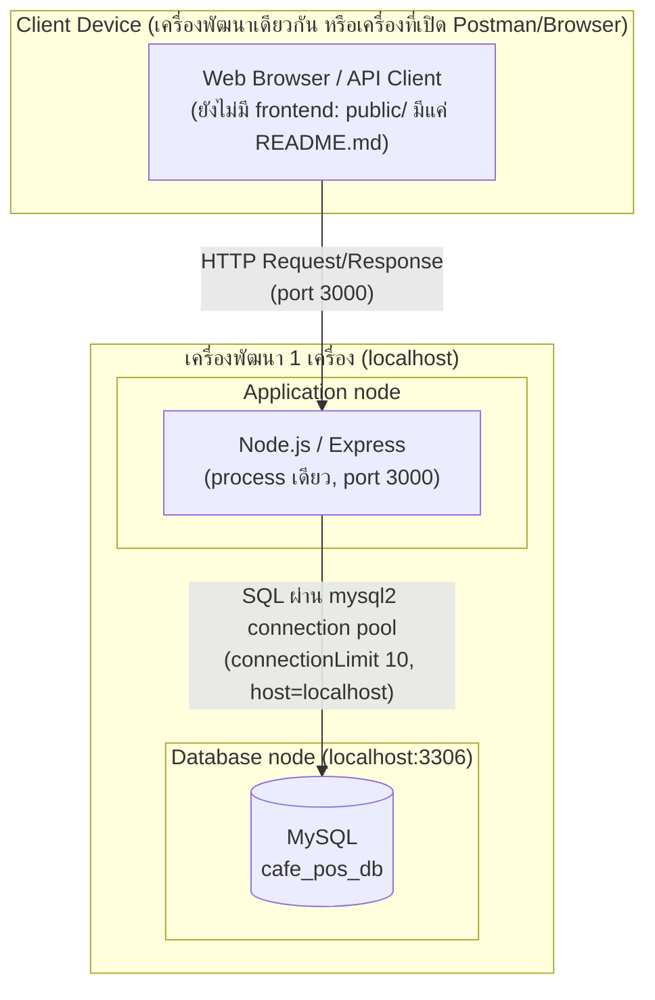
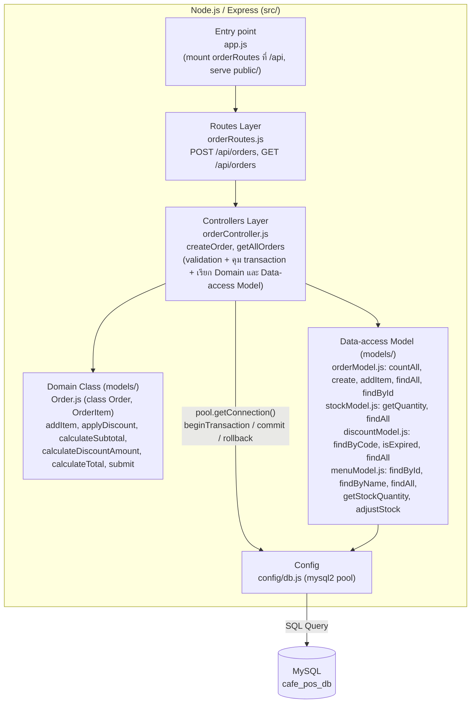

# wk11 — Architecture Diagram (4+1 View: Physical View และ Development View)

ระบบ: Cafe POS (`cafe-pos-system`) — Node.js / Express + MySQL
อ้างอิงโครงสร้างจาก repository จริง ณ commit `WK10` (branch `main`)

---

## 1. Physical View (deployment topology จริง)

กลุ่มรันระบบบนเครื่องพัฒนา โดย Node.js server และ MySQL อยู่ในเครื่องเดียวกัน (`DB_HOST=localhost`, `DB_PORT=3306`, `PORT=3000` ตาม `.env.example`) จึงวาดเป็น 3 บทบาท (Client / Application / Database) โดยระบุชัดว่า Application กับ Database อยู่บนเครื่องเดียวกัน (localhost) ไม่มี load balancer และไม่มีเซิร์ฟเวอร์แยกตามสาขา (หลายสาขาจำลองด้วย `branch_id` ในฐานข้อมูลเดียว)

---

## 2. Development View (การแบ่ง component/module ของ source code)

เลือกเวอร์ชัน (ก): กลุ่มแยก Data-access Model แล้ว และมี `Order.js` (domain class) ตามที่ wk06 บังคับ ชื่อไฟล์และ method ด้านล่างตรวจกับโค้ดใน `src/` จริง

**หมายเหตุให้ตรงกับโค้ดปัจจุบัน (ไม่วาดให้สมบูรณ์เกินจริง):**

- ยังไม่มี `menuRoutes.js` / `menuController.js` — `menuModel.js` มีอยู่ใน `models/` แต่ยังไม่มี controller เรียกใช้ (ไม่มีลูกศรจาก Controller ถึง `menuModel` ในโค้ดปัจจุบัน)
- `createOrder` ครอบเฉพาะขั้นตอน INSERT ออเดอร์และรายการสินค้าด้วย transaction ส่วนการเช็คสต็อก (`stockModel.getQuantity`) ทำก่อนเริ่ม transaction และโค้ดยังไม่มีขั้นตอนตัดสต็อกหลังขายใน flow นี้ จึงยังมี race condition ระหว่างเช็คสต็อกกับบันทึกออเดอร์ได้
- `public/` ยังไม่มีไฟล์ frontend จริง (มีเพียง `README.md`) จึงไม่วาด Presentation Layer เป็นกล่องแยก
- ยังไม่มี service แยก (เช่น payment service) ทุกอย่างอยู่ใน process เดียว

---

## 3. สรุปสถาปัตยกรรม

ระบบของกลุ่มเป็น Monolithic + Layered Architecture: deploy เป็น Node.js process เดียวที่ `localhost:3000` เชื่อมต่อ MySQL `cafe_pos_db` ผ่าน connection pool เดียว (`src/config/db.js`) ทีมมี 5 คน ระยะเวลาพัฒนาสั้น และขอบเขตปัจจุบันมี endpoint เดียวคือ `/api/orders` จึงยังไม่จำเป็นต้องแยก service โค้ดแบ่ง layer ตามที่ตั้งไว้ตั้งแต่สัปดาห์ 5 เป็น routes (`orderRoutes.js`) → controllers (`orderController.js`) → models (domain class `Order.js` และ data-access `orderModel.js`, `stockModel.js`, `discountModel.js`, `menuModel.js`) → config (`db.js`) ซึ่งช่วยแยกความรับผิดชอบโดยไม่ต้องแบกรับความซับซ้อนของการ deploy หลาย service และหลายสาขาจำลองด้วยคอลัมน์ `branch_id` ในฐานข้อมูลเดียว
